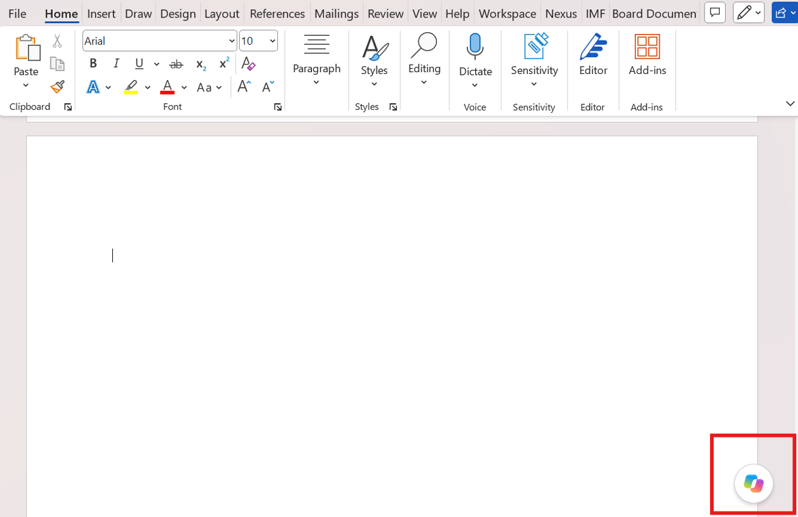
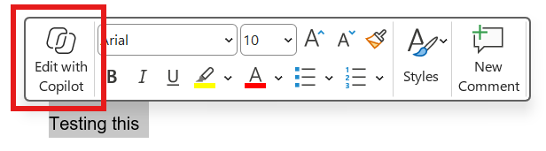
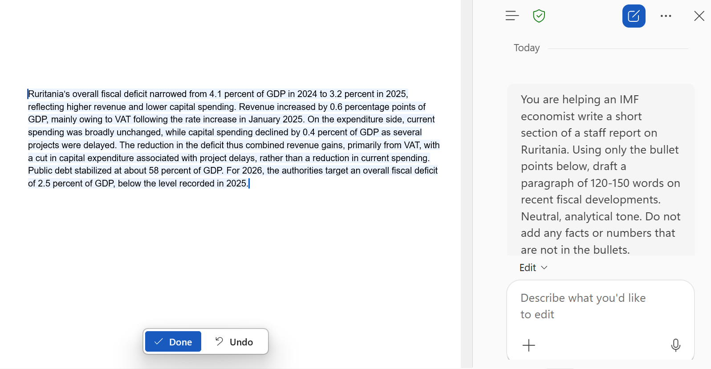
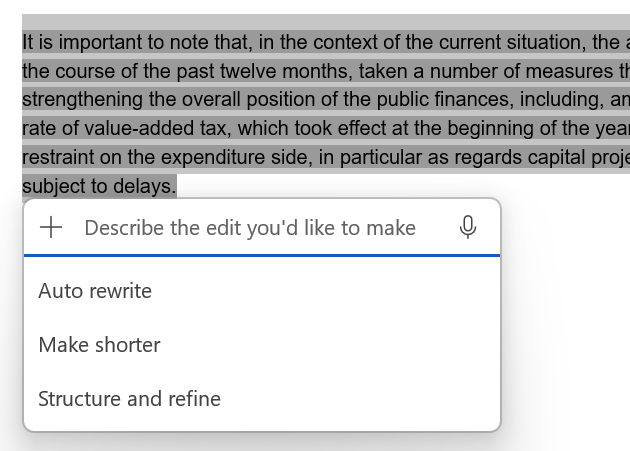

## Introduction

Microsoft 365 Copilot adds an AI assistant inside Word that can see the document you have open. In this tutorial we use it for the three things economists do most: draft a paragraph from bullet points, rewrite text we already have, and summarize a document.

Nothing needs to be installed as Desktop Word and Copilot are standard at the Fund.

## Opening Copilot

Copilot appears in three places in Word. The Copilot button at the right end of the Home tab opens a chat pane on the right-hand side of the window.



A small Copilot icon appears in the left margin whenever the cursor is on an empty line or when you select text and select options.



## Drafting from Bullet Points

Open a blank document, click the Copilot icon in the margin and paste the prompt below.

```         
You are helping an IMF economist write a short section of a staff report on Ruritania. Using only the bullet points below, draft a paragraph of 120-150 words on recent fiscal developments. Neutral, analytical tone. Do not add any facts or numbers that are not in the bullets.

- Overall fiscal deficit fell from 4.1 percent of GDP in 2024 to 3.2 percent in 2025.
- Revenue rose by 0.6 percentage points of GDP, mainly from VAT after the rate increase in January 2025.
- Current spending was broadly unchanged; capital spending was cut by 0.4 percent of GDP as several projects were delayed.
- Public debt stabilized at about 58 percent of GDP.
- The authorities target a deficit of 2.5 percent of GDP in 2026.
```

Copilot writes the paragraph directly into the document, with a small toolbar underneath to keep it, regenerate it, or refine it with a follow-up instruction.



Now check the draft against the bullets: every number should be unchanged, and nothing should have been added. The last sentence of the prompt, "Do not add any facts or numbers that are not in the bullets", is what makes this check pass most of the time. Without it, Copilot tends to supply reasons we never gave it, such as why the projects were delayed.

## Rewriting Existing Text

Drafting from scratch is the showy feature, but rewriting is the one we use most. Paste the paragraph below into the document. It is deliberately wordy.

```         
It is important to note that, in the context of the current situation, the authorities of Ruritania have, over the course of the past twelve months, taken a number of measures that are aimed at the objective of strengthening the overall position of the public finances, including, among other things, an increase in the rate of value-added tax, which took effect at the beginning of the year, as well as a certain degree of restraint on the expenditure side, in particular as regards capital projects, a number of which have been subject to delays.
```

Select it, click the Copilot icon that appears next to the selection and choose from the options like rewrite, make it shorter, etc.



Instead of the menu, we can also give our own instruction in the chat pane while the text is selected:

```         
Rewrite the selected paragraph in two sentences. Keep all the facts and drop the filler. Staff-report tone.
```

Make sure to always double check the results. Rewriting is where Copilot is most reliable, because all the facts are already on the page, but it is also where qualifiers get lost: "about 58 percent" becomes "58 percent" and "broadly unchanged" becomes "unchanged".

## Summarizing a Document

Paste the note below into a new document. It is the text we use for the rest of this tutorial and the next one.

```         
Ruritania: Recent Economic Developments

Growth slowed to 2.1 percent in 2025, from 3.4 percent in 2024, as the VAT increase weighed on private consumption and a weaker external environment reduced export growth. Inflation fell to 3.0 percent by December 2025, within the central bank's 2-4 percent target band, allowing the policy rate to be cut by 50 basis points in two steps during the second half of the year.

The fiscal position improved. The overall deficit narrowed to 3.2 percent of GDP in 2025 from 4.1 percent in 2024, driven by higher VAT revenue and lower capital spending. Public debt stabilized at about 58 percent of GDP. The authorities aim to bring the deficit to 2.5 percent of GDP in 2026 and to put debt on a declining path thereafter.

The external position remains comfortable. The current account deficit widened slightly to 2.8 percent of GDP, financed mainly by foreign direct investment, and reserves stood at 5.1 months of imports at end-2025. Risks are tilted to the downside: a sharper slowdown in trading partners would weigh on exports, and a further delay in capital projects could lower medium-term growth. On the fiscal side, the 3.5 percent of GDP deficit outturn in 2025 leaves little room for slippage if the 2026 target is to be met.
```

Open the chat pane from the Home tab. The pane can see the whole document, so we can ask for a summary directly:

```         
Summarize this document in five bullet points for a non-specialist reader. Keep every number exactly as in the text.
```

The answer appears in the pane, not in the document, but this allows you to ask additional questions or follow up with a specific discussion with the document.

## What to Watch For

-   **Invented detail.** Asked about something the input does not cover, Copilot produces plausible filler rather than saying so. Always add "use only the information provided", and check that it did.
-   **Dropped qualifiers.** Rewrites turn "about 58 percent" into "58 percent" and "broadly unchanged" into "unchanged". In Fund text those words carry meaning.
-   **No live data.** Copilot in Word does not know the WEO numbers. If the answer depends on data, the data have to be in the document, in a referenced file, or in the prompt.

You've now seen the three everyday uses of Copilot in Word: draft, rewrite and summarize. The pattern is the same each time: give Copilot the material, tell it to use only that material, and check the result against it. The next tutorial turns Copilot into a reviewer that checks the note we just pasted for the inconsistency it contains.

## Learn More

-   [Welcome to Copilot in Word](https://support.microsoft.com/en-us/word/welcome-to-copilot-in-word), Microsoft's own short guide with the current button names.
-   [Microsoft 365 Copilot help and learning](https://support.microsoft.com/en-us/copilot), the hub for all the Copilot apps.
