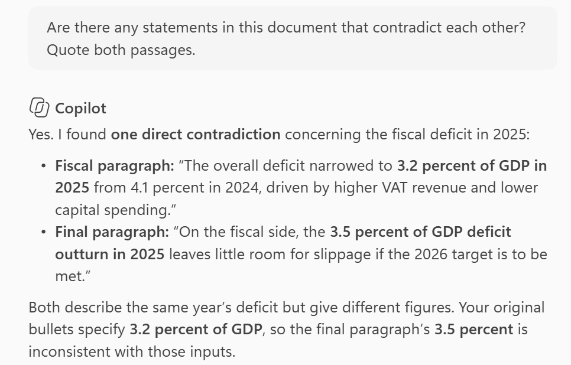
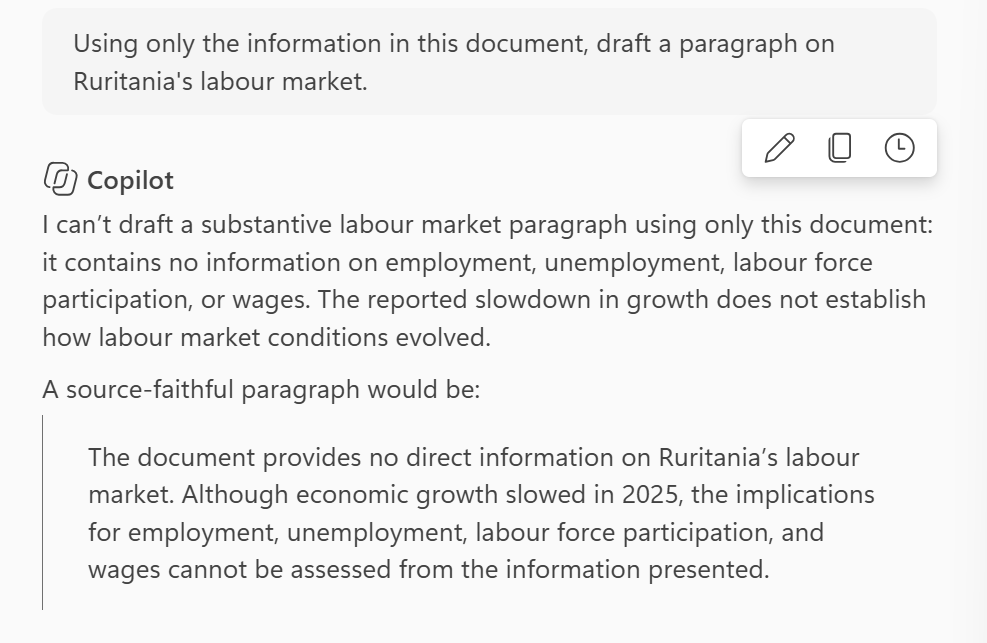

## Introduction

The first Word tutorial introduces the basics of using Copilot in Word. This one uses it to check text: find inconsistencies, list every number with its source, test whether it invents content, and draft an update from an earlier document. These are the uses that save the most time in a review cycle, and they are also where it pays to know what Copilot cannot do.

Paste the note below into a blank document. It is the same Ruritania note as before, and it contains one deliberate inconsistency.

```         
Ruritania: Recent Economic Developments

Growth slowed to 2.1 percent in 2025, from 3.4 percent in 2024, as the VAT increase weighed on private consumption and a weaker external environment reduced export growth. Inflation fell to 3.0 percent by December 2025, within the central bank's 2-4 percent target band, allowing the policy rate to be cut by 50 basis points in two steps during the second half of the year.

The fiscal position improved. The overall deficit narrowed to 3.2 percent of GDP in 2025 from 4.1 percent in 2024, driven by higher VAT revenue and lower capital spending. Public debt stabilized at about 58 percent of GDP. The authorities aim to bring the deficit to 2.5 percent of GDP in 2026 and to put debt on a declining path thereafter.

The external position remains comfortable. The current account deficit widened slightly to 2.8 percent of GDP, financed mainly by foreign direct investment, and reserves stood at 5.1 months of imports at end-2025. Risks are tilted to the downside: a sharper slowdown in trading partners would weigh on exports, and a further delay in capital projects could lower medium-term growth. On the fiscal side, the 3.5 percent of GDP deficit outturn in 2025 leaves little room for slippage if the 2026 target is to be met.
```

## Finding Inconsistencies

The 2025 deficit is 3.2 percent of GDP in the second paragraph and 3.5 percent in the third. Open the chat pane from the Home tab and ask Copilot to find it:

```         
Are there any statements in this document that contradict each other? Quote both passages.
```



Copilot is good at helping find inconsistencies within your own document.

## Listing Every Number

A second prompt often catches what the first one misses, because it forces Copilot to go through the text line by line:

```         
List every number in this document as a table with three columns: the number, what it measures, and the sentence it comes from.
```

The table is also useful on its own. It is the quickest way to build a list of figures to verify against the source data before a document goes out.

## Testing for Invented Content

The failure to watch for is the opposite of a missed inconsistency: content that is not in the source at all. Ask for something the note does not cover:

```         
Using only the information in this document, draft a paragraph on Ruritania's labour market.
```

The note says nothing about the labour market. A good answer says so, like the below.



It is good to run tests like this in each tool you use; it tells you how much to trust its summaries.

## Rewriting for a Different Audience

Copilot is reliable at changing register, because all the facts stay on the page. Try both of these on the first paragraph and compare what changes:

```         
Rewrite the first paragraph for a press release aimed at the general public. 60 words maximum, no jargon.
```

```         
Rewrite the first paragraph for an audience of central bank economists. Keep every number.
```

What should not change in either version is the numbers and the direction of every statement. This is another good verification you can check in your system.

## Drafting from Another Document

Most Fund drafts are updates of earlier material. In *Draft with Copilot*, typing `/` or clicking the + sign opens a menu for files you have access to. Save the note as *Ruritania 2025 note.docx* in your OneDrive, open a new blank document, click the margin icon and try:

```         
Draft a one-page update on Ruritania's fiscal position based on /Ruritania 2025 note. Keep the same structure. Mark every place where a new number is needed with [UPDATE].
```

The `[UPDATE]` instruction tells Copilot to leave a visible gap rather than guess, which is what we want whenever it works from old material. Copilot can only reference files you already have permission to open, but it will use any such file without asking whether it should, so the rules on which documents may be used with Copilot apply to referenced files too.

## What to Watch For

-   **Formatting.** Generated text can arrive with its own heading styles and bullet formats, and needs tidying with the document's styles.
-   **Track changes.** Copilot inserts text directly rather than as tracked changes. To keep a record of what it altered, work in a copy and compare documents afterwards.
-   **Long documents.** On very long documents, summaries and checks lean on the beginning and the end. Check a long report section by section.

You've now used Copilot as a reviewer: it found the inconsistency, listed every number for verification, showed whether it invents content, and drafted an update with visible gaps where new numbers belong.

## Learn More

-   [Welcome to Copilot in Word](https://support.microsoft.com/en-us/word/welcome-to-copilot-in-word), including the current guidance on referencing files.
