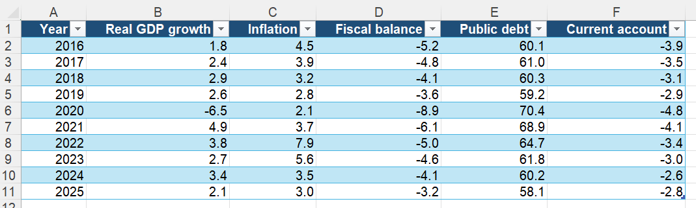
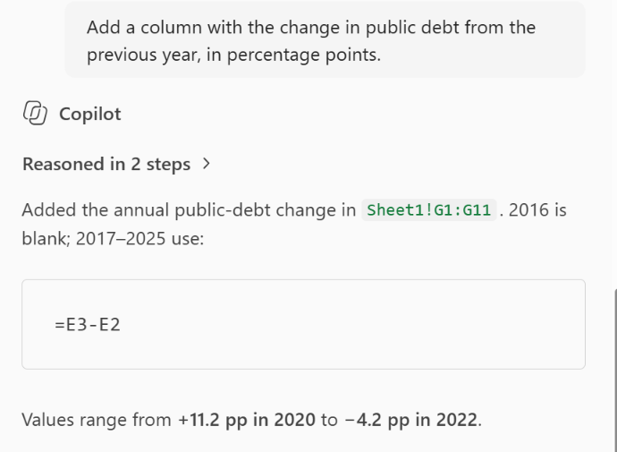
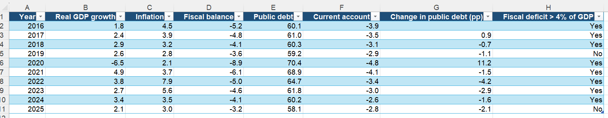
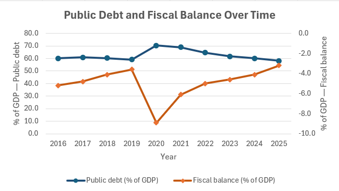
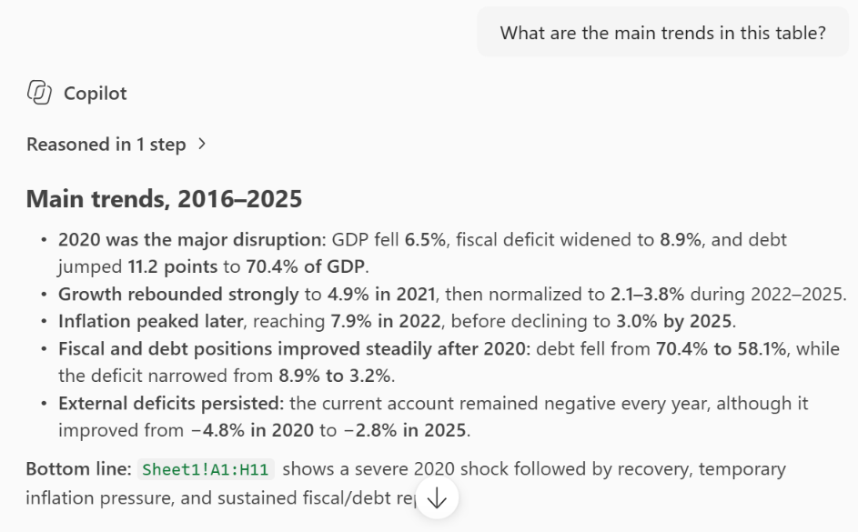

## Introduction

Copilot in Excel works on data that is formatted as a table and helps with four things: formulas, highlighting and sorting, quick charts and insights, and questions about the data, all through a chat pane. In this tutorial we do each of them on a small Ruritania dataset. The next tutorial goes further with Python-based analysis.

Two requirements catch most people out: the workbook must be saved on OneDrive or SharePoint with AutoSave on, and the data must be in an Excel table with a cell inside it selected.

## The Data

Open a new workbook, save it to your OneDrive as *Ruritania.xlsx*, and paste the block below into cell A1 or ask Copilot to do it for you. The columns are percent (growth, inflation) and percent of GDP (balance, debt, current account).

```         
Year    Real GDP growth Inflation   Fiscal balance  Public debt Current account
2016    1.8 4.5 -5.2    60.1    -3.9
2017    2.4 3.9 -4.8    61.0    -3.5
2018    2.9 3.2 -4.1    60.3    -3.1
2019    2.6 2.8 -3.6    59.2    -2.9
2020    -6.5    2.1 -8.9    70.4    -4.8
2021    4.9 3.7 -6.1    68.9    -4.1
2022    3.8 7.9 -5.0    64.7    -3.4
2023    2.7 5.6 -4.6    61.8    -3.0
2024    3.4 3.5 -4.1    60.2    -2.6
2025    2.1 3.0 -3.2    58.1    -2.8
```

The table should look like the following format to work best:



## Adding a Formula Column

Ask for a new column in plain words. Copilot proposes the formula, explains it, and inserts it when you confirm.

```         
Add a column with the change in public debt from the previous year, in percentage points.
```



Look at the formula before accepting it. The first row has no previous year, so a good formula returns a blank or zero there rather than an error. A second one to try:

```         
Add a column that says "Yes" if the fiscal deficit was larger than 4 percent of GDP and "No" otherwise.
```

Your file should now look like this:



## Highlighting, Sorting and Filtering

These prompts change the sheet directly, through conditional formatting, sorting and filters, so Ctrl+Z undoes them if the result is not what you wanted.

```         
Highlight the years where real GDP growth was negative.
```

```         
Sort the table by inflation, highest first.
```

```         
Filter to the years where public debt was above 60 percent of GDP.
```

## Getting Charts and Insights

Ask for a chart or for Copilot's own reading of the data and to easily plot things. For example to create a chart you can ask.

```         
Plot public debt and the fiscal balance over time on one chart.
```



And to better understand the trends of the data you could ask:

```         
What are the main trends in this table?
```



The chart is a quick look, not a publication chart. For staff-report charts, use the R or Python tutorials.

## Asking Questions About the Data

Copilot answers questions by computing on the table, for example try the following two.

```         
Which year had the largest fiscal deficit, and what was real GDP growth that year?
```

```         
What was average inflation in 2016-2019 compared with 2021-2025?
```

Confirm any number you are going to use with a formula. For the second question, `=AVERAGE(C2:C5)` and `=AVERAGE(C7:C11)` to make sure.

## What to Watch For

-   **Only the table.** Copilot works best on the table you have selected.
-   **Check the formula, not the words.** The explanation can be right while the formula references the wrong column. Click into the new column and read it.
-   **Computed answers are not audited.** Treat an answer in the pane like a colleague's mental arithmetic: usually right, worth confirming.
-   **Size.** On very large tables, responses slow down or fail. Work on an extract.

You've now used Copilot in Excel for formulas, formatting, charts and questions. The underlying habit is the same as in Word: let Copilot propose, then confirm with a formula or a glance at the sheet. The next tutorial shows what Copilot can do when it is allowed to write Python.

## Learn More

-   [Get started with Copilot in Excel](https://support.microsoft.com/en-us/copilot-excel), Microsoft's guide, with the current requirements and example prompts.
