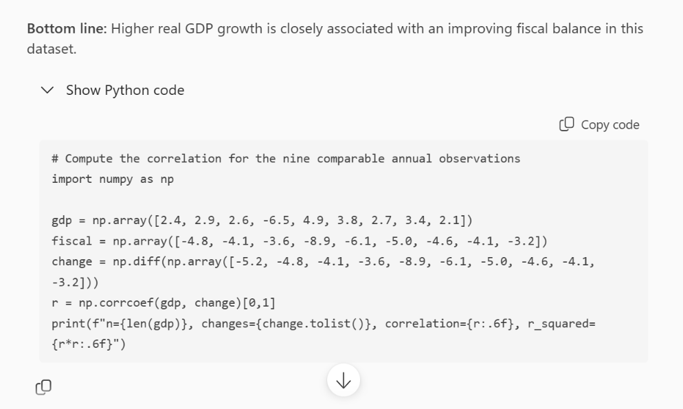
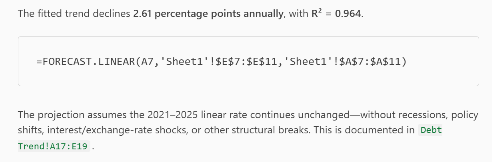
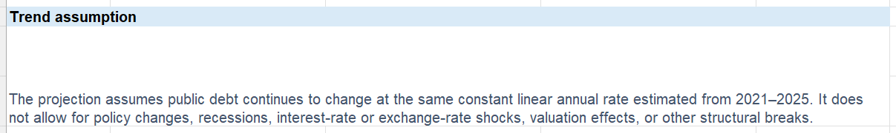

## Introduction

For questions that go beyond formulas, such as correlations, trends and simple models, Copilot in Excel can switch to *Advanced analysis*, in which it writes and runs Python inside the workbook. The code and its results land in a new sheet, so you can read exactly what was done. This tutorial uses the same Ruritania table as the previous one.

The feature requires Python in Excel, which is available to all economists at the Fund in desktop Excel.

## Asking an Analytical Question

To initiate advanced analytics, ask the kind of question a formula cannot answer in one step like the following:

```         
Is there a relationship between real GDP growth and the change in the fiscal balance from the previous year? Show a scatter plot and report the correlation.
```

Copilot writes the Python, runs it, and shows the chart and the number. You can also adjust the models on the top left hand corner for harder questions.

The best part is that you can also see the Python code directly, for you to follow along on the analysis.



If you are not as familiar with Python, you can simply ask Copilot to explain it to you as well, for example.

```         
Explain the Python code in this analysis step by step, for someone who knows Excel but not Python.
```

The best part of this integration is that you can perform advanced analytics within the workbook but also inspect and understand them.

## Going Further

Two more questions that work well on this table are for example:

```         
Compute a three-year moving average of inflation and add it as a column in the analysis.
```

```         
Fit a linear trend to public debt for 2021-2025 and extend it to 2028. Show the fitted values in a table and say what the trend assumes.
```

The second one invites Copilot to state its assumption (a straight line through five points). You will see that it states this assumption when prompted.





## Taking the Results Into Your Own Code

The Python Copilot writes can be copied into your own work and extended as needed. Two differences to know: Python in Excel has no internet access and a fixed set of libraries (pandas, statsmodels, matplotlib and seaborn among them), and it runs in the cloud, not on your machine. For anything that is more demanding, or that needs the full library ecosystem, the Azure OpenAI tutorials in this book move the same workflow into a script.

## What to Watch For

-   **Draft analysis.** The code is a first attempt. Check the variable it chose, the sample it used, and any transformation it applied silently.
-   **Assumptions.** Ask for them every time a projection or a model is involved.
-   **Data location.** The table is sent to Microsoft's cloud to run the Python.

You've now seen Copilot produce reproducible analysis in Excel using Python you can read, check and reuse. The next tutorial moves to PowerPoint, where Copilot turns a document into a first-draft presentation.

## Learn More

-   [Get an advanced data analysis using Copilot in Excel with Python](https://support.microsoft.com/en-us/office/get-an-advanced-data-analysis-using-copilot-in-excel-with-python-364e4ae9-9343-4d56-952a-5f62b0f70db6), Microsoft's guide with the version requirements.
-   [Get started with Copilot in Excel](https://support.microsoft.com/en-us/copilot-excel), for the basics.
