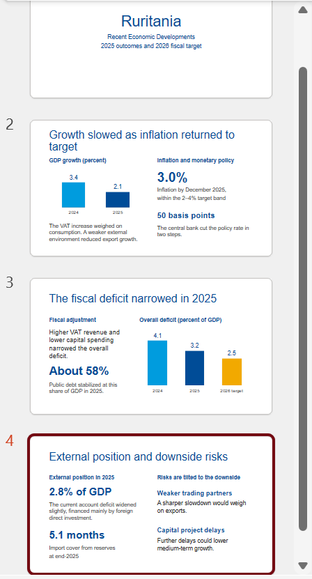
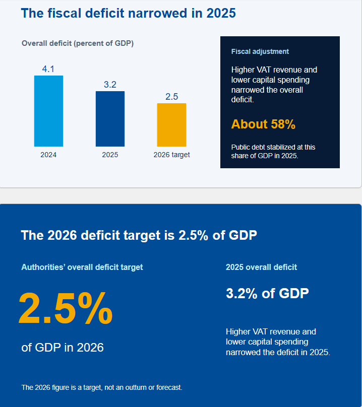

## Introduction

Copilot in PowerPoint turns a document into a first-draft presentation, adds and reorganizes slides, writes speaker notes, and summarizes a presentation you have received. In this tutorial we build a short briefing deck from the Ruritania note, refine it, and then use Copilot to read a deck instead of writing one.

You need a Copilot licence and the source document saved on OneDrive or SharePoint.

## Preparing the Source Document

Copilot uses the heading structure of a Word document to decide how to split it into slides, so a document with Word's built-in heading styles produces a much better deck than one without. Create a Word document called *Ruritania 2025 note.docx* in your OneDrive with the text below, applying Heading 1 to the title and Heading 2 to the four section headings.

```         
Ruritania: Recent Economic Developments

Growth and inflation
Growth slowed to 2.1 percent in 2025, from 3.4 percent in 2024, as the VAT increase weighed on private consumption and a weaker external environment reduced export growth. Inflation fell to 3.0 percent by December 2025, within the central bank's 2-4 percent target band, and the policy rate was cut by 50 basis points in two steps.

Fiscal position
The overall deficit narrowed to 3.2 percent of GDP in 2025 from 4.1 percent in 2024, driven by higher VAT revenue and lower capital spending. Public debt stabilized at about 58 percent of GDP. The authorities target a deficit of 2.5 percent of GDP in 2026.

External position
The current account deficit widened slightly to 2.8 percent of GDP, financed mainly by foreign direct investment. Reserves stood at 5.1 months of imports at end-2025.

Risks
Risks are tilted to the downside: a sharper slowdown in trading partners would weigh on exports, and further delays in capital projects could lower medium-term growth.
```

Keep source documents small; Microsoft's guidance is under 24 MB.

## Creating a Deck from the Document

Open a new presentation, click Copilot tab, and choose the file and state something like:

```         
Create a presentation from /Ruritania 2025 note. One slide per section, plus a title slide.
```

Copilot produces the slides, applies layouts, and writes speaker notes from the text it did not fit on the slides.



Read every slide against the note. The common faults are a number rounded or changed, a risk promoted into a fact, and sometimes a closing slide is added that generalizes beyond the text.

## Starting from an Outline Instead

For a deck that is not a one-to-one copy of a document, you can also ask Copilot for an outline first and then produce a presentation.

```         
Create a 6-slide briefing on Ruritania's fiscal position for a non-specialist audience, based on /Ruritania 2025 note. Show me the outline first.
```

Editing the outline is where you decide the story; generating slides from an outline you have approved saves most of the rework.

## Adding and Reorganizing Slides

With a presentation open, the pane takes editing instructions. Try the following prompts and see how well they work!

```         
Add a slide after the fiscal slide on the 2026 deficit target, using only the note.
```

```         
Organize this presentation into sections with a divider slide before each.
```

```         
Make the external position slide more concise: three bullets, no more than ten words each.
```

## Reading a Presentation

Copilot is as useful on presentations you receive as on those you write. Open any presentation and ask things like:

```         
Summarize this presentation in five bullet points.
```

```         
Which slides mention public debt, and what do they say?
```

```         
Write speaker notes for slide 3: one or two sentences per bullet, using only what is on the slide.
```

## Using the Fund's Template

When you start from a presentation that already uses the Fund's template and then ask Copilot to create slides, the design follows the template (mostly the colors). Starting from a blank design gives a generic Microsoft design that has to be reworked.

You can also click on the + sign and use the Designer functionality in Copilot, it helps you format presentations into more curated beautiful designs like the below.



## What to Watch For

-   **Numbers on slides.** Check every figure against the source; slides invite rounding.
-   **Charts.** Copilot adds decorative images and simple shapes, not data charts. Make charts in Excel, R or Python and paste them in.
-   **Density.** First drafts tend to put too much text on each slide. Ask for fewer words rather than editing by hand.

You've now built a presentation from a document, refined it, and used Copilot to read a presentation. The next tutorial covers Outlook and Teams, where Copilot summarizes threads and meetings.

## Learn More

-   [Create a new presentation with Copilot in PowerPoint](https://support.microsoft.com/en-us/copilot-powerpoint), Microsoft's guide to creating from a file and from a prompt.
-   [Frequently asked questions about Copilot in PowerPoint](https://support.microsoft.com/office/3e229188-9086-4f4c-9f9f-824cd25ae84f), including file limits and supported formats.
